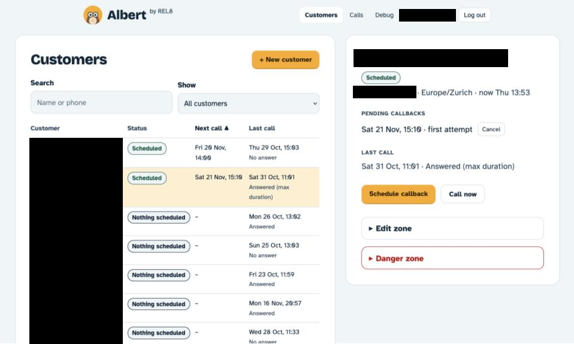
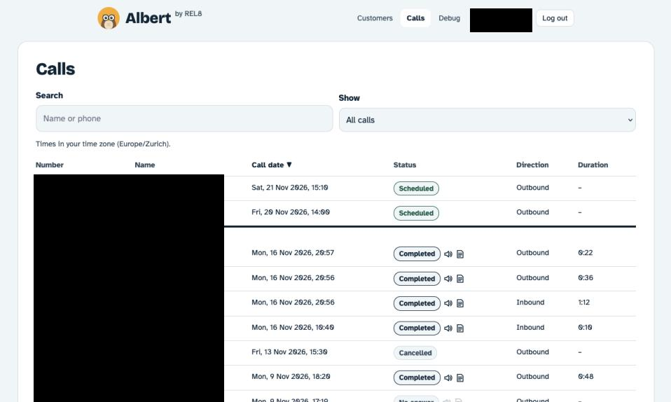

# Albert

[](https://github.com/mcbuehler/albert/actions/workflows/tests.yml)
[](LICENSE)
[](https://www.python.org/downloads/release/python-3120/)

Backend and assistant configurations for **Albert**, a [Vapi](https://vapi.ai/) voice assistant with long-term memory ([Hindsight](https://ui.hindsight.vectorize.io)). Albert answers inbound calls, places outbound and scheduled callbacks, archives call records and available recordings and transcripts, and provides a staff page to manage customers and review calls.

[](public/assets/img/backend1.jpg)
[](public/assets/img/backend2.jpg)

## Quickstart

Use [uv](https://docs.astral.sh/uv/) with Python 3.12. A working deployment needs [Supabase](https://supabase.com/dashboard), [Hindsight Cloud](https://ui.hindsight.vectorize.io), [Vapi](https://dashboard.vapi.ai/signup) and [Brave Search API](https://api-dashboard.search.brave.com/) accounts, plus a compatible phone connection.
See [setup](docs/setup.md) for account links, credentials, database and Vapi configuration. Review the [known production issues](docs/known-production-issues.md) before connecting real callers.

```bash
git clone https://github.com/mcbuehler/albert.git
cd albert
uv sync --locked --python 3.12
cp .env.example .env
```

After completing setup and filling in `.env`:

```bash
uv run --locked --python 3.12 --env-file .env gunicorn main:app --bind 127.0.0.1:8000 --timeout 150
```

Open `http://localhost:8000` for the staff page, then follow the [smoke test](docs/vapi-setup.md#smoke-test).

## Documentation

- [Setup and accounts](docs/setup.md) · [Environment variables](docs/configuration.md) · [Vapi setup](docs/vapi-setup.md)
- [Deployment](docs/deployment.md) · [Development and tests](docs/development.md) (no provider accounts needed for tests)
- [Architecture](docs/architecture.md) · [Call archive](docs/call-archive-schema.md) · [Known production issues](docs/known-production-issues.md)

## License

Albert is available under the [MIT License](LICENSE).

## Acknowledgements

Thank you to OpenAI and Anthropic for providing API credits, and to the ETH Entrepreneur Club for its
[RocketHub accelerator](https://www.entrepreneur-club.org/rockethub). Thanks to everyone who used and
tested Albert and helped us improve it.

The backend started from [Vercel's Flask example](https://github.com/vercel/vercel/tree/main/examples/flask).
