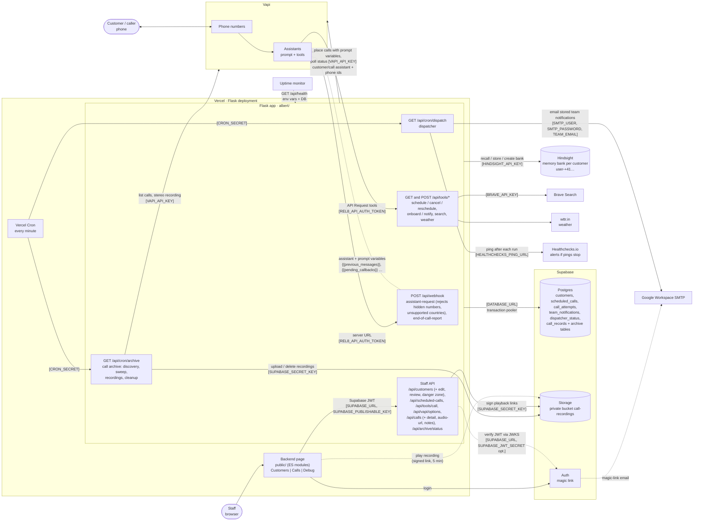

# Albert: system overview

Albert is a voice companion. Vapi runs the phone calls, and the Flask backend (`albert/`) provides customer data, memory, scheduling and tools. The diagram shows a Vercel deployment with environment variable names in brackets. See the [quickstart](../README.md#quickstart) and [Vapi setup guide](vapi-setup.md) to reproduce it.

## Main flows

- **Inbound call:** Vapi sends `assistant-request` to the webhook. For a customer, the backend loads their memory (5 s limit) and replies with their assistant and prompt variables. Supported non-customers get the US/Canada or Swiss inbound assistant (falling back to `VAPI_ASSISTANT_ID`) without memory; unsupported countries and callers without a usable number (suppressed, "anonymous", non-E.164) are rejected with a spoken message, customers included. The archive still saves these calls ("Unknown caller", "Number withheld").
- **Outbound call:** every minute Vercel Cron triggers the dispatcher. It claims due callbacks, loads memory and dials through the Vapi API, one call per Vapi number and per customer at a time. Results are polled from Vapi: anything but an answered call (no answer, busy, voicemail via Vapi's voicemail detection) is retried after 60 minutes, up to 4 attempts, and retries only happen within 09:00–22:00 customer-local time. If Vapi's reply is lost, the attempt stays open and the next run matches it against Vapi's call list instead of dialling twice.
- **After a call:** the `end-of-call-report` is stored in the customer's Hindsight bank (customers only; not when the call ended with `voicemail` or `customer-did-not-answer`).
- **Staff:** they log in with a Supabase magic link and then onboard customers (this creates the memory bank), edit name / time zone / default assistant (pending callbacks keep their local time), review inbound sign-ups, schedule calls, use Call now (refused while the customer or number is busy or the customer opted out; never retried), and use the danger zone (erase memory; delete customer, which also removes their archived calls, recordings and notes).
- **Team notifications:** the `notify_team` and `onboard_customer` tools store a row; each dispatcher run emails new rows to `TEAM_EMAIL`.
- **Call archive:** every minute Vercel Cron calls `/api/cron/archive` (`archive.discover_calls`, ~45 s budget).
  It lists new calls from Vapi (all callers, in overlapping time windows that split when full), refreshes
  calls still running or without transcript, sweeps the configured provider retention window oldest first
  (14 days by default, matching the original account), deletes recordings queued by deletions, and copies up to 3 stereo recordings per
  run: `vapi.recording_url` reads Vapi's signed redirect without following it, the file is streamed
  (max 100 MiB) and `storage.upload_object` stores it as `call-recordings/calls/<record-uuid>.<wav|mp3>`.
  Only spoken customer/assistant messages are kept in the transcript. The archive scans calls visible to the
  Vapi API key, independently of customer consent for Hindsight memory. Recording transfers retry with backoff
  for up to 24 h after discovery. Staff can run it from Debug ("Run archive now"), which also
  shows its status (`/api/archive/status`). Tables `call_records` + 5 helpers (migrations 014–015); see
  [database contracts](call-archive-schema.md).
- **Calls tab:** `GET /api/calls` lists archived calls, local attempts not archived yet and upcoming
  callbacks (search, status filter, sort, paging; `calls.js`). A row opens the detail dialog (`call-detail.js`):
  `GET /api/calls/<entry-id>` (transcript, notes), `POST …/audio-url` (5-minute signed Supabase link the
  browser plays directly, renewed at the same position) and `POST …/notes` (staff notes; author from the login).
- **Deletion:** deleting a customer removes their archived calls (linked or from their number), notes and
  recordings (queued for the cron) and writes markers so no scan re-imports them. Erase memory keeps the archive.

## Prompt variables

At the start of each call the backend sends these as `variableValues`, which the assistant prompt uses as `{{name}}`. For inbound calls they go in the webhook's reply to `assistant-request` (`vapi.assistant_request_response`). For outbound calls they go in the `assistantOverrides` of the call request (`vapi.place_outbound_call`). Defaults are in `albert/config.py`.

| Variable | Customer | Non-customer | Source |
|---|---|---|---|
| `{{previous_messages}}` | Hindsight memories (the call is rejected or not dialled if they can't be loaded) | "No previous conversations with this customer." | `memory.recall_for_phone` |
| `{{call_instructions}}` | Staff instructions (Schedule / Call now) or the customer's (`schedule_callback` `instructions`, e.g. a reminder, prefixed "Requested by the customer: "), otherwise "No special instructions for this call." | same default | `scheduled_calls.instructions` |
| `{{pending_callbacks}}` | Pending callbacks in local time, each with the customer's own instructions (e.g. a reminder; staff instructions aren't listed), joined with "; " ("No pending callbacks." / "…could not be loaded right now.") | "No pending callbacks." | `customers.callback_variables` |
| `{{customer_first_name}}` | First name | "unknown" | `customers.customer_variables` |
| `{{customer_last_name}}` | Last name | "unknown" | `customers.customer_variables` |
| `{{customer_local_now}}` | e.g. "Thursday, 15 October 2026, 15:36 (Europe/Zurich, UTC+02:00)" | same, in Europe/Zurich | `customers.customer_variables` |

Inbound calls always get the default `{{call_instructions}}`. Don't use Vapi's `{{now}}`, which is in UTC.

Variables are set once at the start of the call. During a long call, the difference between `{{customer_local_now}}` and the current time can affect relative callback requests.

## Environment variables

| Variable | Required | Used by | Purpose |
|---|---|---|---|
| `DATABASE_URL` | yes | `db.py` | Supabase Postgres via the transaction pooler (port 6543, `sslmode=require`) |
| `REL8_API_AUTH_TOKEN` | yes | `auth.py` | Bearer token Vapi sends to the webhook and tool endpoints |
| `CRON_SECRET` | yes | `auth.py` | Bearer token Vercel Cron sends to `/api/cron/dispatch` and `/api/cron/archive` |
| `SUPABASE_URL` | yes | `auth.py`, `routes.py` | Staff login: JWKS for JWT checks, and page config for the browser |
| `SUPABASE_PUBLISHABLE_KEY` | yes | `routes.py` | Public key for supabase-js on the backend page |
| `SUPABASE_JWT_SECRET` | no | `auth.py` | Only for legacy HS256 Supabase projects |
| `SUPABASE_SECRET_KEY` | yes | `storage.py` | Backend-only key for uploading, deleting and signing playback links for call recordings in the private `call-recordings` bucket |
| `VAPI_API_KEY` | yes | `vapi.py`, `routes.py` | Vapi REST API: place calls, poll status, list numbers and assistants, list calls and recordings for the archive |
| `VAPI_ASSISTANT_ID` | yes | `vapi.py` | Fallback assistant for supported non-customer inbound calls |
| `VAPI_INBOUND_ASSISTANT_ID_US`, `VAPI_INBOUND_ASSISTANT_ID_CH` | no | `vapi.py` | Country-specific assistants for unknown callers; US also covers Canada |
| `VAPI_ASSISTANT_ID_US`, `VAPI_PHONE_NUMBER_ID_US` | for US/Canada sign-up | `onboarding.py` | Defaults assigned to customers who sign up during a call |
| `VAPI_ASSISTANT_ID_CH`, `VAPI_PHONE_NUMBER_ID_CH` | for Swiss sign-up | `onboarding.py` | Defaults assigned to customers who sign up during a call |
| `HINDSIGHT_API_KEY` | yes | `vapi.py`, `routes.py`, `onboarding.py` | Memory: recall, store, create, erase and delete banks |
| `BRAVE_API_KEY` | yes | `search.py` | Search tool |
| `SMTP_USER`, `SMTP_PASSWORD`, `TEAM_EMAIL` | for team email | `notify.py` | Google Workspace SMTP login and notification recipient |
| `HEALTHCHECKS_PING_URL` | no | `dispatcher.py` | Healthchecks.io ping URL; each dispatcher run pings it (`/fail` if claiming failed), so you get an alert when the cron stops |
| `LOCAL_LOGGING` | no | `app.py` | `1`: INFO logs to `logs/app.log` (local only) |
| `LOG_STDOUT` | no | `app.py` | `1` (with `LOCAL_LOGGING`): also log to stdout |

Business rules (calling hours, retries, timeouts) are kept in `albert/config.py`, not in env vars.

_Edit the diagram in any editor. You can preview it at <https://mermaid.live> or in the VS Code Markdown preview with a Mermaid extension._
